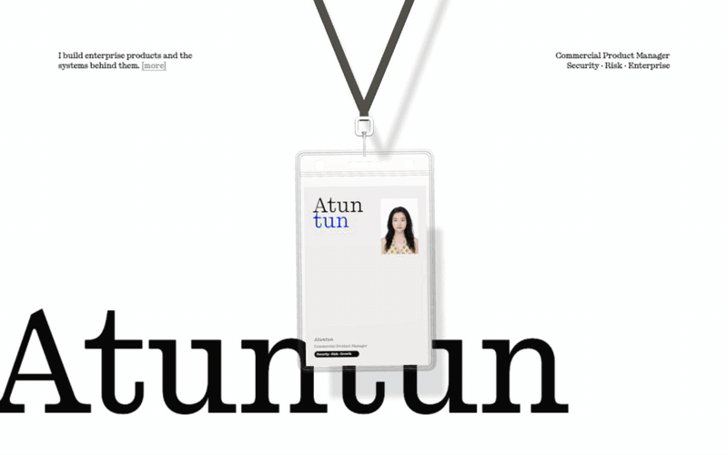

# 个人网站 2.0

**先拥有一个完整的动态个人网站，再把里面的故事换成你的。**

这个 Skill 会先复现下方 Atuntun 网站的当前版本：可以拖动、旋转和回摆的 3D 胸卡，工作 / 教育 / 项目经历，作品封面墙，以及带竖版头像的 About 抽屉。完成预览后，Agent 会主动请你上传简历，再拆解和替换成你的资料。



[观看完整 Demo（MP4）](docs/demo/demo.mp4) · [查看 Skill](SKILL.md)

## 三步开始

### 1. 跟 Agent 说：安装这个 Skill

把下面这句话发给支持安装 Skill、编辑文件和运行项目的 Agent：

```text
请帮我安装「个人网站 2.0」Skill：
https://github.com/panggungunvibe/personal-website-2.0
请安装完整仓库，包括 assets、scripts、references，不要只下载 SKILL.md。
```

它在界面中的名称是 **个人网站 2.0**，技术标识是 `personal-website-2-0`。安装后若 Agent 尚未发现技能，重新打开会话。

### 2. 装完后，告诉它复刻这个网站

```text
用「个人网站 2.0」帮我复刻这个网站，先给我完整的预览效果。
```

支持 `$` 调用的 Agent 也可以使用：

```text
请使用 $personal-website-2-0 复刻这个网站。
```

Agent 会复制内置网站、安装依赖、运行并验证预览。**第一步就有完整效果，不需要先写一大堆需求。** 源码、布局和必要素材随 Skill 打包，不依赖重新抓取参考网站。

### 3. 它会主动请你上传简历

预览完成后，Agent 会引导你提供简历和竖版头像。支持 PDF、Word、图片或直接粘贴文字，具体读取能力取决于你使用的 Agent。

| 网站内容 | 你可以提供什么 | Agent 会做什么 |
| --- | --- | --- |
| 个人信息 | 展示名 / 英文名、头像、一句话介绍、联系方式 | 同步更新首页、胸卡、About、页脚和页面标题 |
| 工作经历 | 简历里的公司、部门、时间、岗位和成果 | 按真实雇主整理，区分同公司不同部门 |
| 教育经历 | 学校、专业、学位、时间和亮点 | 整理为可以点开的教育详情 |
| 项目经历 | 项目背景、你的职责、成果、截图和链接 | 增删项目、调整排序；部分项目可改成自定义主题 |
| 作品 / 笔记 | 小红书等原帖链接及封面，也可提供其他作品 | 替换作品墙封面，保留点击跳转原帖 |
| 社交账号 | 想公开展示的平台及主页链接 | 替换页脚的账号入口 |

资料不全也能继续：网站会直接显示 **`#此部分缺失内容：具体缺项`**。你看到哪里缺，再发给 Agent 补上即可。没有提供的经历和成绩不会被编造。

## Demo 里有什么

- **桌面 3D 胸卡**：从按住的位置拖动；挂绳、金属扣和卡片联动；松手后旋转回摆，内卡与外壳保持贴合。
- **经历详情**：工作、教育、项目点击展开，内容用列表呈现。
- **作品墙**：封面、分类筛选、卡片拖动和原帖跳转。
- **About**：桌面侧边抽屉、手机底部面板，头像按 2:3 竖版完整展示。
- **响应式布局**：桌面与手机分别适配；移动端沿用当前版本的静态胸卡与弹性挂绳表现。

Demo 来自实际浏览器操作。第一阶段保留 Atuntun 的示例资料，第二阶段才改成使用者本人的内容。不同浏览器和 GPU 的抗锯齿、光照呈现可能有细微差别。

## 手动运行（可选）

日常使用只需上面的三句话。如果想自己运行，需要 Python 3.9+，以及满足 Vite 要求的 Node.js（20.19+ 或 22.12+ 的受支持版本）。

```bash
git clone https://github.com/panggungunvibe/personal-website-2.0.git
cd personal-website-2.0
python3 scripts/scaffold.py "$(pwd)/../my-personal-website"
cd ../my-personal-website
npm ci
npm run dev -- --host 127.0.0.1 --port 4188 --strictPort
```

打开终端输出的预览地址。构建静态网站：

```bash
npm run build
```

输出位于 `dist/`。发布到互联网是单独一步；Skill 不会自动上传你的原始简历或发布个人资料。

## 仓库结构

```text
SKILL.md                         Agent 的两阶段工作流程
agents/openai.yaml               Skill 展示名称和调用提示
assets/site-template/           当前网站的完整可运行模板
assets/template-manifest.json   模板文件的完整性校验
scripts/scaffold.py             复制模板，不覆盖已有项目
scripts/audit_personalization.py 检查个性化后是否遗留示例身份
references/personalization.md   简历拆解与所有替换位置
docs/demo/                      实际操作 Demo
```

本仓库提供的是这款个人网站的固定模板，不是通用网页抓取器。技术栈为 Vite、原生 JavaScript、Three.js 和 Rapier。

## 来源与许可

网站的视觉参考来自 [Sam Cheng](https://www.samfcheng.com/)，此版本由 Atuntun 个性化，并重建了胸卡交互。原创代码与 Skill 说明采用 [MIT License](LICENSE)；字体、参考站视觉素材和人物 / 帖子示例素材的范围另见 [素材说明](THIRD_PARTY_NOTICES.md)，不一并授予 MIT 许可。
